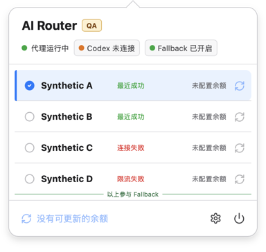
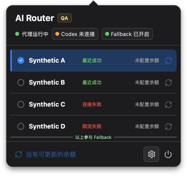
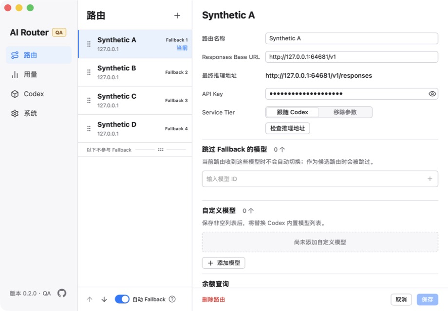
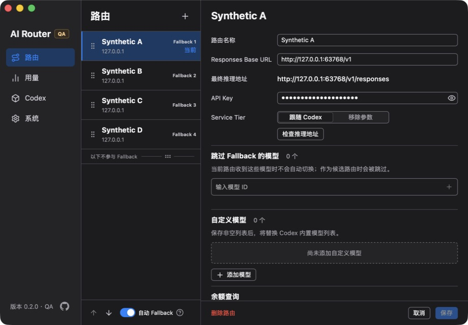

# AI Router

English | [简体中文](./README.zh-CN.md)

[](https://github.com/Angry3D/ai-router/actions/workflows/ci.yml)
[](https://github.com/Angry3D/ai-router/releases/latest)
[](./LICENSE)
[](./SUPPORT.md)

AI Router is a local menu bar app for macOS developers that switches between
Codex CLI or the Codex app and multiple upstreams that are compatible with the
OpenAI Responses API. It queries balances, falls back across routes
automatically, manages custom Codex model catalogs and the image-generation
MCP, and summarizes request usage locally.

The project is still in early development. It ships a Simplified Chinese and
English interface, an official Apple Silicon DMG and source code. It is not a
stable general-purpose network proxy or an enterprise gateway.

**[Download the official DMG from GitHub Releases](https://github.com/Angry3D/ai-router/releases)**

## Screenshots

The screenshots come from the isolated `AI Router QA.app` and synthetic data;
they contain no real routes, API keys or request content. The current
screenshots show the Chinese interface; English captures will follow in a later
release. See [README image notes](./docs/images/readme/README.md) for capture
and provenance records.

### Menu and route switching

| Light theme                                                                                                                                                                   | Dark theme                                                                                                                                                                  |
| ----------------------------------------------------------------------------------------------------------------------------------------------------------------------------- | --------------------------------------------------------------------------------------------------------------------------------------------------------------------------- |
|  |  |

Switch the current route from the menu bar and watch the Codex connection state
and fallback state in real time.

### Route configuration

| Light theme                                                                                                                                                                       | Dark theme                                                                                                                                                                       |
| ---------------------------------------------------------------------------------------------------------------------------------------------------------------------------------- | -------------------------------------------------------------------------------------------------------------------------------------------------------------------------------- |
|  |  |

The routes page keeps upstream addresses, balances and fallback order in one
place, and every route can select its own upstream protocol.

## Contents

- [Features](#features)
- [Support scope](#support-scope)
- [Installation and first run](#installation-and-first-run)
- [In-app updates](#in-app-updates)
- [Network egress](#network-egress)
- [Data and privacy](#data-and-privacy)
- [Troubleshooting](#troubleshooting)
- [Building from source](#building-from-source)
- [Engineering and community](#engineering-and-community)
- [License](#license)

## Features

- See proxy, Codex and fallback state in the menu bar, and switch the current
  route with one click.
- Store route details for multiple Responses API upstreams, query balances and
  fall back in order on failure.
- Choose an upstream protocol per route: forward Responses untouched, or bridge
  upstreams that only speak Chat Completions while keeping the Responses
  contract for Codex.
- Connect Codex through a protected configuration projection; disconnecting
  restores the previously saved configuration target.
- Manage the custom model catalog and the image-generation MCP without
  hand-editing the matching Codex configuration fragments.
- Inspect local request metadata such as tokens, estimated cost and latency by
  route, model, status and time.
- Browse the model price table and update GPT model prices from the official
  OpenAI pricing page with a manual "Sync page"; the result only writes to the
  local price table.
- Back up and restore local settings, and keep bounded diagnostics.

## Support scope

| Item             | Current boundary                                                                                                |
| ---------------- | --------------------------------------------------------------------------------------------------------------- |
| Operating system | macOS 13 or later                                                                                               |
| Hardware         | Apple Silicon (`aarch64`)                                                                                       |
| Codex            | Requires an installed and working Codex CLI or Codex app; the automatic compatibility check pins `codex-cli 0.162.0` |
| Interface language | Simplified Chinese / English (follows macOS by default, manual switch available)                             |
| Distribution     | The official DMG uses ad-hoc signing, not Developer ID signing or Apple notarization; in-app updates require explicit confirmation |
| Network boundary | The local proxy listens on loopback only; upstream requests go to the Responses API address configured by the user |

Unlisted Codex versions may work, but there is no compatibility guarantee at
the moment. Windows, Linux and Intel Macs are out of scope. See the
[support documentation](./SUPPORT.md) for the complete boundaries.

## Installation and first run

Download the asset named `AI.Router_<version>_aarch64.dmg` from
[GitHub Releases](https://github.com/Angry3D/ai-router/releases) only. Open the
DMG, drag `AI Router.app` into Applications, and launch it from Finder.

The official DMG uses an ad-hoc macOS signature to keep the code inside the
bundle consistent, but it carries no Apple Developer ID identity and is not
notarized or verified by Apple. If macOS blocks the first launch, open System
Settings → Privacy & Security, confirm in the Security section that the blocked
item is `AI Router.app`, choose "Open Anyway", and allow it in the system
confirmation dialog. The project does not recommend terminal commands that
disable or bypass Gatekeeper.

After the first launch:

1. Open AI Router in the menu bar, add a route under Settings → Routes, and enter
   a Responses API compatible address and key.
2. Save and test the route; once its state is healthy, make it the current
   route.
3. Connect Codex explicitly from the menu. Connecting updates the transport
   fields of the current Codex provider through the protected projection;
   disconnecting restores the saved recovery target.

Before the first connection, read
[Data, privacy and recovery](./docs/engineering/data-privacy-recovery.md) to
confirm you understand how API keys are stored and where Codex configuration
ownership ends.

Releases also provide the updater archive, `.sig`, `latest.json`, `SHA256SUMS`
and GitHub provenance. A normal first install only needs the DMG; the other
files serve update authentication, manual verification and build provenance.
See [Release and application updates](./docs/engineering/application-updates.md)
for the exact verification steps.

## In-app updates

Official installs can check manually under Settings → System → Application
updates. The app checks silently once it reaches the running state and then
keeps checking in the background on a fixed cadence; background checks never
download, install, notify or interrupt proxy requests.

When a new stable version appears, the settings page first shows the highlights
reviewed by the release owner. Downloading and installing require one explicit
confirmation, and the restart after installation requires another; the update
package must pass the project updater signature check first.

For older versions, install the current DMG manually as described in the
[support documentation](./SUPPORT.md#installation-and-update-support). See
[Release and application updates](./docs/engineering/application-updates.md)
for the scheduling cadence, failure retries and signature verification rules.

## Network egress

Settings → System → Global outbound proxy defaults to "Follow system":
inference, balance queries, model discovery, image generation and image
downloads, and application updates use the manual HTTP/HTTPS/SOCKS proxy and
bypass rules of macOS; connections go direct when no applicable proxy exists,
and you can switch to a "Custom proxy" instead. Loopback addresses always
connect directly, and a failed proxy never falls back to a direct connection.
Pricing sync and Codex session retrieval still follow the system network stack.

PAC/WPAD is not executed. See
[Routing and resilience](./docs/engineering/routing-resilience.md) for the
complete proxy decisions, fail-closed behavior and bypass rules.

## Data and privacy

- Routes, API keys, settings, request metadata and recovery state live in
  `router.sqlite3` in the application data directory.
- API keys never go into regular runtime logs, but they are stored as raw bytes
  in the SQLite database protected by private file permissions; the app does not
  use the macOS Keychain and performs no application-layer encryption today.
- Request records keep only bounded metadata such as route, status, tokens and
  estimated cost; raw prompts and full response bodies are not stored.
- Runtime logs use fixed error codes and bounded counters, and must not contain
  API keys, Authorization headers, request bodies, complete configurations,
  upstream URLs or raw provider messages.
- Recovery points store critical configuration, including route keys and Codex
  configuration recovery information; they contain no request history, usage
  rows or logs.
- AI Router provides no cloud sync. All outbound traffic comes from
  user-configured upstream requests, Codex behavior itself, or the manual "Sync
  page" action in settings, which visits the official OpenAI pricing page in a
  hidden read-only window and writes the GPT model price rows into the local
  price table; it uploads no local data and carries no API key.

See [Data, privacy and recovery](./docs/engineering/data-privacy-recovery.md)
for exact paths, backup scope and recovery limits. Report security issues
through the private channel in the [security policy](./SECURITY.md) instead of
a public issue.

## Troubleshooting

- The official DMG is blocked on first launch: use System Settings → Privacy &
  Security → Open Anyway. Do not run Gatekeeper bypass commands; confirm the
  download came from GitHub Releases and check `SHA256SUMS` and provenance.
- An in-app update fails: keep the current installation, retry from the update
  section, or open GitHub Releases and install the DMG manually. Do not replace
  the existing app when the signature or metadata check fails.
- Codex shows "Changed" or "Conflict": do not overwrite `config.toml` directly.
  Disconnect Codex first, inspect the current provider and retained fields, and
  then use the preview or repair actions the interface offers.
- The database fails to start: keep the application data directory, and do not
  hand-edit or delete the SQLite files, WAL files or recovery points. Pick a
  verified recovery point in the startup recovery screen first, and only decide
  to start over when none is available.
- Submitting diagnostics: provide only the version, macOS release, reproduction
  steps and the fixed error codes the interface shows. Never upload API keys,
  complete configurations, databases, raw logs or real request content.

See the [support documentation](./SUPPORT.md) for more.

## Building from source

### Build prerequisites

Prepare a supported Mac and install:

- Xcode Command Line Tools: `xcode-select --install`
- Node.js `22.22.3`, preferably through `nvm` reading the repository `.nvmrc`
- pnpm `10.33.2`, activated through Corepack
- Rust/Cargo `1.97.1`; `rust-toolchain.toml` selects the toolchain and the
  `aarch64-apple-darwin` target
- A Codex CLI or Codex app that starts correctly

```sh
git clone https://github.com/Angry3D/ai-router.git
cd ai-router

nvm install
nvm use
corepack enable
corepack prepare pnpm@10.33.2 --activate
pnpm install --frozen-lockfile
```

### Check commands

Run the project checks first:

```sh
pnpm docs:check
pnpm lint
pnpm typecheck
pnpm test
cargo fmt --check
cargo clippy --workspace --all-targets -- -D warnings
cargo test --workspace
pnpm build
```

### Build the macOS app

```sh
pnpm tauri:prod:build
```

The artifact lands in `target/release/bundle/macos/AI Router.app`. A
self-built `.app` has no Developer ID signature, Apple notarization or official
updater public key, so macOS may warn or refuse to start it. The project
provides no Gatekeeper bypass steps and does not imply that source builds are
verified by Apple.

### Development run

Regular interface development uses the isolated QA identity and data
directory:

```sh
pnpm tauri:dev
```

`pnpm tauri:dev` is equivalent to `pnpm tauri:qa:dev`: it uses the QA identity
and a separate data directory, never takes over the production Codex
configuration, and picks a temporary proxy port assigned by the system. A debug
build using the production identity (`com.relax.airouter`) refuses to start so
that development processes cannot read or write the production data directory
or the real Codex configuration.

Other useful check commands:

| Purpose           | Command               |
| ----------------- | --------------------- |
| Generate IPC types | `pnpm generate:types` |
| Version consistency | `pnpm version:check`  |
| Licenses and provenance | `pnpm license:check`  |

## Engineering and community

- [Engineering documentation index](./docs/engineering/README.md)
- [Architecture and code boundaries](./docs/engineering/architecture.md)
- [Routing and resilience](./docs/engineering/routing-resilience.md)
- [Data, privacy and recovery](./docs/engineering/data-privacy-recovery.md)
- [macOS native lifecycle](./docs/engineering/native-lifecycle.md)
- [Release and application updates](./docs/engineering/application-updates.md)
- [Stable release operations](./docs/engineering/releasing.md)
- [Risk-proportional verification](./docs/engineering/verification.md)
- [Contributing guide](./CONTRIBUTING.md)
- [Code of conduct](./CODE_OF_CONDUCT.md)
- [Security policy](./SECURITY.md)

## License

First-party code and interface compositions visible in the AI Router
screenshots are licensed under the [MIT License](./LICENSE). See the
[third-party notices](./THIRD_PARTY_NOTICES.md) for third-party components,
derived icons, Lucide icons rendered in the screenshots, embedded fixtures and
pricing data sources.
